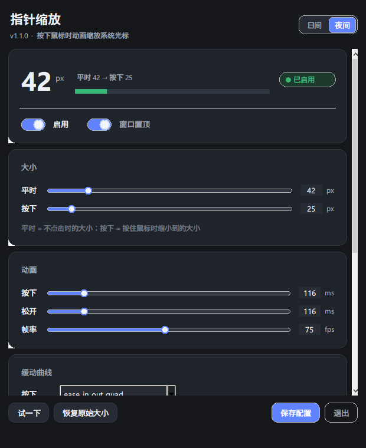

# Pointer Zoom

> The pointer stays large at rest. **Press the mouse and it shrinks with an easing animation; release and it springs back.**
> The pointer is the *real system cursor* the whole time — it keeps moving and clicking normally.

English · [中文](README.md)


[](https://github.com/WWKKX2/pointer-zoom/actions/workflows/tests.yml)

| Light theme | Dark theme |
|---|---|
|  |  |

```
48px at rest ──press (80ms ease_in_quad)───► 25px
     ▲                                         │
     └────── release (83ms ease_out_quad) ─────┘
```

## Features

- **Shrink on press, restore on release** — independent duration and easing curve for each direction
- **17 built-in easing curves**, including overshooting `back` / `elastic` / `bounce`
- **Modern GUI** — rounded card layout with hand-drawn sliders, switches and segmented
  controls, light / dark themes switchable in one click; live sliders, and a curve
  preview that plots the *actual pixel-size trajectory*
- **Pointer stays usable** — it moves, clicks and drags normally during the animation
- **Native system scaling** — the cursor is never hidden, redrawn, or input-forwarded
- **Four layers of safety** so a crash can never leave your pointer stuck oversized
- Optional headless mode driven purely by hotkeys

## Quick start

Requires Windows 10/11 and Python 3.

```bash
git clone https://github.com/WWKKX2/pointer-zoom.git
cd pointer-zoom
```

**Double-click `start.bat`** to open the GUI. Move the window aside and click a few times on empty desktop — you'll see the pointer shrink and spring back.

For a windowless background process, double-click **`start_nogui.bat`** instead:

| Hotkey | Action |
|---|---|
| `Ctrl+Alt+P` | Enable / disable |
| `Ctrl+Alt+R` | Reset to the original size |
| `Ctrl+Alt+Q` | Quit |

> Hotkeys are configurable in `pointer-zoom.ini`. If one is already taken, the app automatically falls back to an alternate combo and tells you at startup.

### Requirements

| Mode | Requirement |
|---|---|
| GUI | Python 3 **with tkinter** (check "tcl/tk and IDLE" in the python.org installer) |
| Headless | Any Python 3.8+ |

`start.bat` probes common install locations and picks the first interpreter that can `import tkinter`.

## Configuration

Changes made in the GUI are saved back to `pointer-zoom.ini` automatically. You can also edit that file by hand — see [`pointer-zoom.ini.example`](pointer-zoom.ini.example).

```ini
[pointer]
idle_size = 48            ; size at rest, in px. "auto" reuses the current system setting
click_size = 25           ; size to shrink to while pressed
trigger = left            ; left / right / middle / both
enabled = true

[animation]
press_duration_ms = 80    ; 0 = instant
release_duration_ms = 83
press_curve = ease_in_quad
release_curve = ease_out_quad
curve_strength = 3.0      ; overshoot amount, only used by back/elastic curves
fps = 60                  ; every frame = one system cursor redraw; drop to 30 if it flickers
broadcast = settle        ; when to broadcast WM_SETTINGCHANGE, see "Why not every frame"

[hotkeys]
toggle = ctrl+alt+p
reset = ctrl+alt+r
quit = ctrl+alt+q
```

### Recipes

| Goal | Setting |
|---|---|
| Bouncier | `release_curve = ease_out_elastic`, `curve_strength = 2.5` |
| Subtler | `release_curve = ease_out_quad`, `release_duration_ms = 160` |
| Snappier press | `press_duration_ms = 90`, `press_curve = ease_out_quart` |
| Perfectly linear | set both curves to `linear` |
| Grow instead of shrink | `idle_size = 32`, `click_size = 96` |
| Cursor flickers during the animation | keep `broadcast = settle` (default); if it still flickers, lower `fps` to 60 or 30 |

### Why not broadcast every frame

Resizing the cursor goes through the undocumented `SystemParametersInfoW(0x2029)`.
It takes two optional `fWinIni` flags:

- `SPIF_SENDCHANGE` — broadcast `WM_SETTINGCHANGE` to **every top-level window**
- `SPIF_UPDATEINIFILE` — persist the new value to the user profile (this project **never** uses it, so nothing is left behind)

Sending `SPIF_SENDCHANGE` on every frame looks harmless but is exactly what causes
the flicker: every app that reacts to the broadcast re-reads the system cursor
setting. The animation only changes the in-memory value and never writes the
registry — so the registry still holds the *original* size, those apps snap the
cursor back to it, and the next frame overrides them again. At 60 fps that tug of
war happens 60 times a second, which is what you see as flickering.

So animation frames now always use `flags = 0`, and the broadcast happens once,
when the size settles:

```ini
broadcast = settle       ; default: one broadcast when the animation settles
broadcast = every_frame  ; escape hatch: restore the old per-frame behaviour
```

Measured cost of `SystemParametersInfoW` is essentially identical with and without
the broadcast (0.68 ms vs 0.70 ms), which shows the **cursor redraw happens inside
the SPI call, not in the broadcast** — dropping the broadcast does not stop the
size from taking effect.

## How it works

The whole thing is one API call:

```c
SystemParametersInfoW(0x2029 /* SPI_SETCURSORBASESIZE */, 0,
                      (PVOID)(UINT_PTR)size_px,
                      flags);   /* 0 on animation frames, SPIF_SENDCHANGE once it settles */
```

A single call rescales the **entire** system cursor set (arrow, I-beam, hand, all resize arrows, busy) with the hotspot handled by Windows — no bitmap work at all.

- Range is `1 – 256` px, matching the 1–15 scale in Windows Settings (32 / 48 / 64 / … / 256)
- Animation frames use `flags = 0` — **neither `SPIF_UPDATEINIFILE`** (we'd write the user profile 60 times a second) **nor `SPIF_SENDCHANGE`** (we'd broadcast `WM_SETTINGCHANGE` 60 times a second; see above)
- The app **never writes the registry**, so the original size always has a trustworthy source of truth

`0x2029` is an undocumented SPI constant (you won't find the name `SPI_SETCURSORBASESIZE` in the public docs). [`tools/verify_spi.py`](tools/verify_spi.py) re-verifies that it works on any machine.

### Threading

```
main thread (tkinter)     hook thread                  animation thread
  │                          │                            │
  ├─ mainloop                ├─ SetWindowsHookEx          ├─ easing each frame
  ├─ after(60) polling  ◄────┤─ RegisterHotKey            ├─ SystemParametersInfo
  │   (read-only)            ├─ GetMessage loop           │
  └─ slider edits cfg ───────┼─ WH_MOUSE_LL hook ──────────┘
                             └─ WM_HOTKEY
```

Three hard rules:

- **The hook callback only sets a flag.** Anything slow there delays every mouse event, and exceeding `LowLevelHooksTimeout` (300 ms) makes Windows silently drop the hook. Measured callback cost: **176 µs** on average.
- **The GUI never does cross-thread callbacks.** tkinter is not thread-safe; calling `after()` from the hook thread crashes intermittently. The GUI polls read-only state on the main thread instead.
- **Each animation starts from the *current* size**, not the previous target, so rapid clicking never jumps.

## Can the pointer get stuck?

Cursor size is system-wide state, so a crash mid-animation would leave it oversized. Four safeguards:

1. **Self-heal on startup** — the first thing the app does is restore the size
2. **Every exit path covered** — normal quit, window close, hotkey quit, Ctrl+C, unhandled exception all funnel through one `restore()`
3. **Read-only registry** — never written, so your real setting is always intact
4. **Manual escape hatch** — run `reset.bat`, or go to Settings → Accessibility → Mouse pointer and touch → drag back to 1

## CLI

```bash
python src/pointer_zoom.py --curves      # list all 17 curves
python src/pointer_zoom.py --reset       # restore original size and exit
python src/pointer_zoom.py --verbose     # headless, logging every press/release
python tests/test_anim.py                # play the animation and print the size timeline
```

## Project layout

```
pointer-zoom/
├─ start.bat                 launch the GUI
├─ start_nogui.bat           headless background mode
├─ reset.bat                 restore the original size
├─ pointer-zoom.ini.example  sample config
├─ src/
│  ├─ pointer_gui.py         tkinter GUI layout
│  ├─ pz_ui.py               UI skin layer: palette + rounded cards + drawn widgets
│  └─ pointer_zoom.py        core (hook / animation / config)
├─ tests/                    test suite (127 checks)
├─ tools/
│  ├─ verify_spi.py          verify the undocumented SPI works
│  ├─ screenshot.py          GUI screenshot helper
│  ├─ win_capture.py         GDI capture + hand-rolled PNG writer
│  └─ probe_cursor.py        cursor diagnostics (SPI cost / handle churn / rendered size)
│     probe_flicker.py        high-rate cursor visibility sampling
│     probe_size.py           cursor bitmap size trajectory
└─ docs/
   ├─ 技术方案.md             full design doc (Chinese, incl. flicker root cause)
   └─ images/
      ├─ gui-preview.png      GUI preview (light)
      └─ gui-preview-dark.png GUI preview (dark)
```

## Development

```bash
python tests/test_logic.py     # pure logic, no hook, no cursor changes (48 checks)
python tests/test_e2e.py       # end-to-end, synthetic clicks (14 checks)
python tests/test_gui.py       # GUI smoke test (17 checks, needs tkinter)
python tests/test_broadcast.py # flicker-fix regression: broadcast timing (33 checks, no real cursor)
python tests/test_hook.py      # mouse hook diagnostics
python tools/verify_spi.py     # re-verify the undocumented SPI
```

One detail worth noting: synthetic clicks in the end-to-end test could hit whatever window happens to be under the cursor. So the test hook **returns 1 at the outermost layer to swallow the event**, while still calling the real `hook_proc` underneath — identical code path, zero chance of clicking something.

Full design notes: [`docs/技术方案.md`](docs/技术方案.md) (Chinese).

## Known limitations

- **Exclusive fullscreen games** draw their own cursor, so nothing changes there
- **Secure desktop (UAC prompts)** — the hook doesn't fire
- **Remote desktop / VMs** — the host may draw the cursor, so it may not apply
- A few apps cache the cursor size until the pointer moves over them
- Clicks **on the GUI window itself** also trigger the shrink (the hook is global); uncheck "启用" while tuning if that bothers you

## License

[MIT](LICENSE) © 2026 WWKKX2
