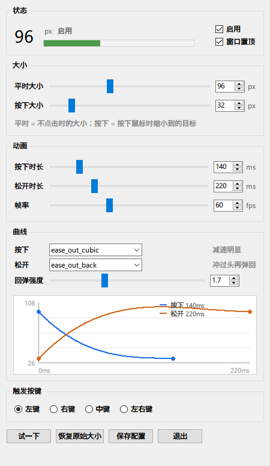

# 指针缩放 Pointer Zoom

> 平时指针大，**按下鼠标时按曲线动画缩小，松开动画恢复**。
> 动画全程指针是真正的系统光标 —— 可以自由移动、正常点击。

[English](README.en.md) · 中文


[](https://github.com/WWKKX2/pointer-zoom/actions/workflows/tests.yml)



```
平时 48px  ──按下（80ms ease_in_quad）───►  25px
    ▲                                         │
    └────── 松开（83ms ease_out_quad）────────┘
```

## 特性

- **按下缩小、松开恢复**，两个方向各自独立配置时长与缓动曲线
- **17 条内置缓动曲线**，含 `back` / `elastic` / `bounce` 等过冲曲线
- **图形界面**：拖滑块即时生效，曲线预览画布画出真实尺寸轨迹
- **指针全程可用**：动画期间指针照常移动、点击、拖拽，交互零影响
- **系统原生缩放**：不隐藏光标、不自绘、不转发输入，热区由系统按比例处理
- **四层安全兜底**：进程崩溃也不会把指针卡在大尺寸
- 无界面后台版可选，纯快捷键操作

## 快速开始

需要 Windows 10/11 和 Python 3。

```bash
git clone https://github.com/WWKKX2/pointer-zoom.git
cd pointer-zoom
```

**双击 `start.bat`** 打开图形界面。把窗口挪到一边，随便点几下桌面空白处，就能看到指针缩小再弹回。

只想要后台常驻、不要窗口，就双击 **`start_nogui.bat`**：

| 快捷键 | 作用 |
|---|---|
| `Ctrl+Alt+P` | 启用 / 停用 |
| `Ctrl+Alt+R` | 立刻恢复原始大小 |
| `Ctrl+Alt+Q` | 退出 |

> 快捷键可以在 `pointer-zoom.ini` 里改。被别的程序占用时会自动降级到备用组合，并在启动信息里提示。

### 环境要求

| 用途 | 要求 |
|---|---|
| 图形界面 | Python 3，且**带 tkinter**（python.org 安装时勾选 "tcl/tk and IDLE"） |
| 后台版 | 任意 Python 3.8+ |

`start.bat` 会自动在常见安装位置里挑一个带 tkinter 的解释器，找不到会给出提示。

## 配置

界面里改的参数会**自动存回 `pointer-zoom.ini`**，也可以直接手改这个文件（首次运行自动生成，格式见 [`pointer-zoom.ini.example`](pointer-zoom.ini.example)）。

```ini
[pointer]
idle_size = 48            ; 平时大小（px），写 auto 表示沿用系统当前设置
click_size = 25           ; 按下时缩小到多少
trigger = left            ; 触发键：left / right / middle / both
enabled = true

[animation]
press_duration_ms = 80    ; 按下动画时长（ms），0 = 瞬间切换
release_duration_ms = 83  ; 松开动画时长
press_curve = ease_in_quad
release_curve = ease_out_quad
curve_strength = 3.0      ; 回弹强度，只对 back / elastic 类曲线有效
fps = 60                  ; 帧率。每一帧 = 系统重绘一次光标，闪/卡就降到 30
broadcast = settle        ; 何时广播 WM_SETTINGCHANGE，见下方「为什么默认不逐帧广播」

[hotkeys]
toggle = ctrl+alt+p
reset = ctrl+alt+r
quit = ctrl+alt+q
```

### 调参配方

| 想要的感觉 | 怎么改 |
|---|---|
| 更弹、更活泼 | 松开曲线选 `ease_out_elastic`，回弹强度拉到 2.5 |
| 更克制、不抢眼 | 松开曲线选 `ease_out_quad`，松开时长降到 160 |
| 按下去要「啪」一下 | 按下时长 90，按下曲线选 `ease_out_quart` |
| 全程匀速、最朴素 | 两条曲线都选 `linear` |
| 不想缩小只想变大 | 平时大小设 32，按下大小设 96（效果反过来） |
| 动画期间指针闪 | 保持 `broadcast = settle`（默认）；仍有闪就把帧率降到 60 或 30 |

### 为什么默认不逐帧广播

改指针尺寸走的是未公开的 `SystemParametersInfoW(0x2029)`。它有两个可选的
`fWinIni` 标志：

- `SPIF_SENDCHANGE` —— 向**所有顶层窗口**广播 `WM_SETTINGCHANGE`
- `SPIF_UPDATEINIFILE` —— 把新值写进用户配置（本项目**从不使用**，避免留下残留）

每帧都带 `SPIF_SENDCHANGE` 看着无害，实际是闪烁的元凶：收到广播的程序会重新读一遍
系统光标设置，而动画只改内存、不写注册表，注册表里还是「原始大小」—— 于是它们把光标
按旧值重设回去，下一帧再被改回来。60fps 就是每秒 60 次这种拉扯，肉眼看到的就是一闪一闪。

所以现在动画帧一律用 `flags = 0`，只在动画落定那一帧广播一次：

```ini
broadcast = settle       ; 默认：落定时广播一次
broadcast = every_frame  ; 退路：恢复旧行为（逐帧广播）
```

实测带不带广播，`SystemParametersInfoW` 的耗时几乎一样（0.68ms vs 0.70ms），说明
**光标重绘发生在 SPI 调用内部，跟广播无关** —— 去掉广播不会让尺寸变化失效。

## 界面上的曲线预览

曲线下拉框下面那块画布会**实时画出两条曲线的真实尺寸轨迹** —— 不是抽象的缓动函数图，而是横轴时间、纵轴指针像素大小：

- 蓝色 = 按下（从平时大小降下去）
- 橙色 = 松开（升回平时大小，`ease_out_back` 会冲过头再回落）

换曲线、改时长、改大小，图立刻跟着变，调参不用靠猜。

## 工作原理

核心只有一行 API：

```c
SystemParametersInfoW(0x2029 /* SPI_SETCURSORBASESIZE */, 0,
                      (PVOID)(UINT_PTR)size_px,
                      flags);   /* 动画帧传 0，落定帧传 SPIF_SENDCHANGE */
```

一次调用，**整套系统光标**（箭头 / 文本 I 形 / 手型 / 各种调整大小箭头 / 忙碌圈）全部按像素等比缩放，热区由系统自己处理 —— 不需要碰任何位图。

- 取值范围 `1 – 256`px，对应 Windows 设置页 1–15 档（32 / 48 / 64 / … / 256）
- 动画帧 `flags = 0`，**既不带 `SPIF_UPDATEINIFILE`**（否则一秒写 60 次用户配置文件），**也不带 `SPIF_SENDCHANGE`**（否则一秒广播 60 次 `WM_SETTINGCHANGE`，见上文）
- 程序**只读不写注册表**，所以「原始大小」永远有一个可靠的真值来源

`0x2029` 是未公开文档的 SPI 常量，公开 API 文档里查不到 `SPI_SETCURSORBASESIZE` 这个名字。仓库里的 [`tools/verify_spi.py`](tools/verify_spi.py) 可以在任意机器上复验它是否可用。

### 线程模型

```
主线程（tkinter）          钩子线程                     动画线程
  │                          │                            │
  ├─ mainloop 事件循环       ├─ SetWindowsHookEx          ├─ 每帧算缓动值
  ├─ after(60) 轮询读数  ◄───┤─ RegisterHotKey            ├─ 调 SystemParametersInfo
  │   （只读，不跨线程写）   ├─ GetMessage 消息循环        │
  └─ 滑块/按钮改配置 ────────┼─ WH_MOUSE_LL 钩子 ──────────┘
       （原子替换 cfg 字典） └─ WM_HOTKEY 处理
```

三个关键约束：

- **钩子回调里只置一个标志位**。回调里做耗时操作会给每次鼠标事件加延迟；超过 `LowLevelHooksTimeout`（默认 300ms）系统会**静默摘掉钩子**。实测回调平均 **176µs**。
- **界面不做跨线程回调**。tkinter 不是线程安全的，从钩子线程调 `after()` 会随机崩溃。界面统一在主线程 `after()` 轮询只读状态。
- **动画起点采样自当前实际尺寸**而非上次目标，所以快速连点不会跳变。

## 指针会不会被卡住

指针尺寸是系统级状态，进程如果在放大状态下死掉就会残留。四层防护：

1. **启动自愈** —— 程序启动第一件事就是把尺寸归位
2. **退出路径全覆盖** —— 正常退出、关窗口、快捷键退出、Ctrl+C、未捕获异常，全部走同一个 `restore()`
3. **只读注册表** —— 从不写入，注册表里永远是用户的真实设置
4. **手动逃生** —— 双击 `reset.bat`；实在不行走 设置 → 辅助功能 → 鼠标指针和触控 → 拖回第 1 档

## 命令行

```bash
python src/pointer_zoom.py --curves      # 列出全部 17 条曲线
python src/pointer_zoom.py --reset       # 恢复原始大小后退出
python src/pointer_zoom.py --verbose     # 后台运行并打印每次按下/松开
python tests/test_anim.py                # 跑一遍动画并打印尺寸时间线
python tests/test_anim.py --idle-size 128 --click-size 24
```

`tests/test_anim.py` 不用开界面就能看曲线形态：

```
  按下（缩小）   48px → 25px，80ms ease_in_quad（先慢后快）
         0ms    48.0px  ████████████████████████████
        34ms    46.9px  █████████████████████████████
        51ms    43.6px  ████████████████████████
        74ms    38.1px  ███████████████████
        92ms    28.4px  █████████
       121ms    25.0px  ██████
  松开（恢复）   25px → 48px，83ms ease_out_quad
        34ms    33.7px  ██████████████
        51ms    40.4px  █████████████████████
        86ms    47.6px  ████████████████████████████
       120ms    48.0px  ████████████████████████████
```

## 项目结构

```
pointer-zoom/
├─ start.bat                 打开图形界面
├─ start_nogui.bat           无窗口后台运行
├─ reset.bat                 一键恢复原始大小
├─ pointer-zoom.ini.example  配置示例
├─ src/
│  ├─ pointer_gui.py         图形界面（tkinter）
│  └─ pointer_zoom.py        主程序（钩子 / 动画 / 配置）
├─ tests/                    测试套件（112 项）
├─ tools/
│  ├─ verify_spi.py          验证系统 API 是否可用
│  ├─ screenshot.py          界面截图工具
│  ├─ win_capture.py         GDI 抓图 + 手写 PNG 底层
│  └─ probe_cursor.py        光标诊断探针（SPI 耗时 / 句柄重建 / 渲染尺寸）
│     probe_flicker.py        高频采样光标可见性
│     probe_size.py           采样光标位图尺寸轨迹
└─ docs/
   ├─ 技术方案.md             完整设计文档（含闪烁根因分析）
   └─ images/
      └─ gui-preview.png     界面预览图
```

## 开发与测试

```bash
python tests/test_logic.py     # 纯逻辑，不碰钩子不改指针（48 项）
python tests/test_e2e.py       # 端到端：合成点击走全链路（14 项）
python tests/test_gui.py       # 界面冒烟测试（17 项，需要 tkinter）
python tests/test_broadcast.py # 闪烁修复回归：广播时机与去重（33 项，不碰真实光标）
python tests/test_hook.py      # 鼠标钩子诊断
python tools/verify_spi.py     # 复验未公开 SPI 是否可用
```

端到端测试有个小设计：合成点击有可能误触屏幕上的窗口，所以测试钩子**在最外层 `return 1` 把事件吞掉**，内层仍调用真实的 `hook_proc` —— 代码路径与线上完全一致，事件却永远不会落到任何窗口。

详细设计见 [`docs/技术方案.md`](docs/技术方案.md)。

## 已知限制

- **独占全屏游戏**里光标由游戏自己绘制，不受影响（也不会缩小）
- **UAC 安全桌面**（弹权限框时）钩子收不到事件
- **远程桌面 / 虚拟机**里部分环境光标由宿主机绘制，可能不生效
- 少数程序会缓存光标尺寸，需要鼠标移上去才刷新
- 界面窗口上的点击**也会**触发缩小（钩子是全局的）；调参嫌碍事时取消勾选「启用」即可

## 许可

[MIT](LICENSE) © 2026 WWKKX2
